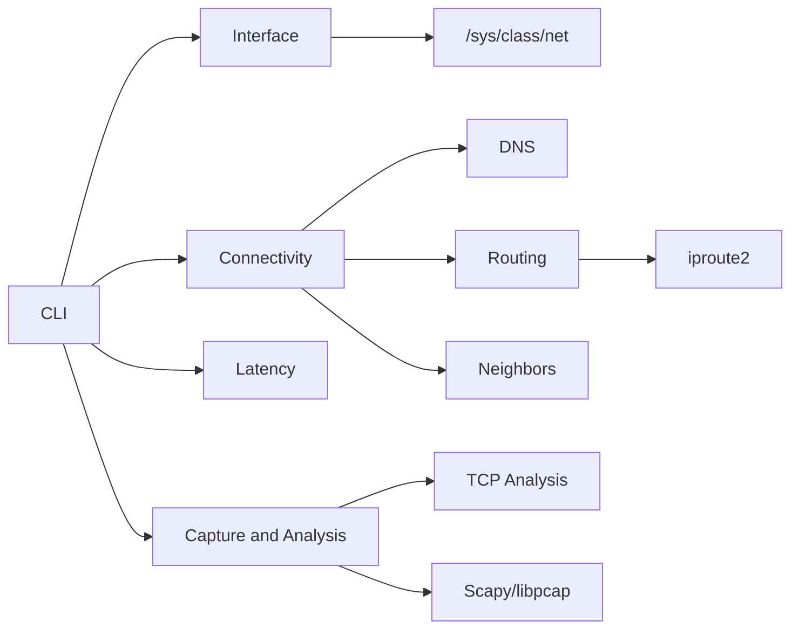

# NetPulse

NetPulse is a Linux-first network latency and connectivity diagnostic tool. It inspects real interfaces, routing, ARP/neighbour state, DNS, TCP connections, and packet metadata. It measures real RTT samples and reports loss, tail latency, jitter, interface counters, and evidence-based troubleshooting guidance.

## Problem and purpose

Network failures are often cross-layer: a route can look correct while ARP is stale, DNS can resolve while TCP is filtered, or ICMP can be blocked while application traffic succeeds. NetPulse separates those checks and reports what Linux observed. It is a learning and portfolio system, not an HFT-grade packet-processing platform.

## Installation

Ubuntu 24.04 or another Linux distribution with `ip`, `ping`, and optionally `tcpdump`, `ethtool`, and Scapy:

```bash
bash scripts/setup_ubuntu.sh
source .venv/bin/activate
netpulse --help
```

Packet capture requires an interface with sufficient privileges. Use `sudo .venv/bin/netpulse capture ...`, or grant a controlled process `CAP_NET_RAW` and `CAP_NET_ADMIN`.

## Documentation

- [Architecture](docs/architecture.md): module responsibilities and design choices.
- [Networking concepts](docs/networking-concepts.md): protocol and measurement fundamentals.
- [Troubleshooting](docs/troubleshooting.md): a layer-by-layer diagnostic workflow.
- [Demonstrations](docs/demos.md): example scenarios and safe testing guidance.
- [Low-latency foundations](docs/low-latency.md): latency, throughput, and hardware considerations.
- [Interview defense](docs/interview-defense.md): project and networking questions.

## Commands

```bash
netpulse interface [INTERFACE]
netpulse diagnose HOST [--port 443] [--probes 20]
netpulse latency HOST [--probes 100] [--timeout 1] [--advanced]
netpulse neighbors
netpulse route
netpulse capture --interface eth0 --duration 30 [--tcp|--udp|--icmp|--arp] [--port 443] [--host 192.0.2.10]
netpulse health
netpulse dns HOSTNAME [--timeout 3]
netpulse tcp HOST PORT [--timeout 3]
netpulse socket-server --tcp --port 9000
netpulse socket-client --host 127.0.0.1 --tcp --port 9000
netpulse socket-server --udp --port 9000
netpulse socket-client --host 127.0.0.1 --udp --port 9000
```

## Architecture



System collection is separated from parsers and statistics so tests do not require network access. JSON output from `ip` is used where possible. `/sys/class/net` supplies counters.

## Latency methodology

NetPulse invokes Linux `ping` and extracts measured ICMP round-trip times. It does not synthesize RTT values. RTT is the time from one request sample to its matching reply. Packet loss is failed replies divided by requested probes. Jitter is the mean absolute difference between consecutive successful RTT samples. p95/p99 are percentile estimates for the slow tail. A p99 matters because tail delays affect repeated operations even when the average looks healthy.

The external `ping` utility measures one ICMP request/response journey and has its own scheduling granularity. `time.monotonic()` is used for DNS, TCP, and local timing. Linux system timing is not promise of hardware-clock precision.

## Packet capture and privacy

Capture stores only packet metadata: timestamp, addresses, protocol, ports, and length. It does not store or display packet payloads. Scapy/libpcap is used on Linux. libpcap provides a capture interface, while Scapy decodes packet metadata. Capture is passive, limited to an explicitly named interface, and bounded by duration. The capture filter supports TCP, UDP, ICMP, ARP, port, and host BPF expressions.

TCP retransmission detection is heuristic: repeated four-tuple and sequence number is a possible retransmission. It cannot distinguish all lost or out-of-order packets, and a capture on a host can miss packets or alter timing.

## Troubleshooting methodology

`diagnose` checks the local interface, IPv4, default route, gateway neighbour entry, gateway reachability, DNS, remote ICMP, and a selected TCP port. PASS/WARN/FAIL is evidence from those tests, followed by possible causes. It never claims an application failure when only ICMP failed.

## Linux commands

- `ip -j addr show`
- `ip -j route show`
- `ip -j neigh show`
- `ping`
- `ethtool`
- `/sys/class/net`
- Scapy/libpcap/tcpdump-compatible capture

## Low-latency concepts

NetPulse is a diagnostic tool, not a low-latency market-data engine. NIC interrupt processing, queuing, CPU scheduling, NUMA locality, kernel receive processing, and application design all influence observed latency. Average RTT hides tails. p99/p99.9, jitter, loss, queue depth, and timeouts are relevant operational metrics.

1GbE, 10GbE, 25GbE, 40GbE, and 100GbE describe link rate. Higher speed does not automatically mean lower latency. Interrupt coalescing, bus placement, NUMA, CPU affinity, and queueing matter. CPU pinning can reduce migration and cache effects; NUMA misplacement can add remote-memory latency. DPDK moves packet processing to user space with polling and memory-mapped NIC queues, but requires careful hardware and ecosystem support. Kernel bypass and OpenOnload reduce/avoid portions of kernel packet processing in specialized deployments. NetPulse makes no DPDK or kernel-bypass performance claims.

## Testing

Install the project and its test dependency in the active Python environment:

```bash
python3 -m pip install -e .
python3 -m pip install pytest
```

Then run the unit tests:

```bash
python3 -m pytest -q
```

## Limitations

No real-network results are assumed or stored. ICMP may be blocked independently of TCP. Neighbour entries are local cache observations. Interface counters are process-observed totals and may wrap. Captures need privilege and are not guaranteed to include every packet. Retransmission and TCP connection counts are heuristics.

## Security

NetPulse performs only explicitly requested resolution, ping, TCP connection, route inspection, and capture. It has no payload capture, credential storage, database, scanning mode, or exploitation behavior. Do not run an untrusted BPF filter or capture on an interface you are not authorized to inspect.

## Future improvements

- JSON/text report modes
- Packet timestamps from hardware where available
- Per-direction TCP state machine tracking
- ICMP type/code diagnostics
- Persistent baseline comparison
- Optional PCAP export as a separate opt-in

## Docker

Build the image from the project root:

```bash
docker build -t netpulse .
```

Run the existing CLI in a container:

```bash
docker run --rm --network host netpulse --help
docker run --rm --network host netpulse interface
docker run --rm --network host netpulse diagnose example.com --port 443
```

`--network host` uses the Linux host's network namespace, so route and interface
inspection is more representative of the host than Docker's default isolated
network. Host networking is supported by Docker Engine on Linux; Docker Desktop
on macOS and Windows runs containers inside a Linux VM and does not provide the
same direct view of the native host network.

Packet capture needs additional Linux capabilities. Grant them only to the
capture container and only when needed. The image includes libpcap for Scapy's
BPF capture filters:

```bash
docker run --rm --network host \
  --cap-add=NET_RAW \
  --cap-add=NET_ADMIN \
  netpulse capture --interface eth0 --duration 10 --tcp
```

Replace `eth0` with an interface visible to the container. Do not use
`--privileged` for routine diagnostics. Host security policy, rootless Docker,
or platform restrictions may still prevent capture even when capabilities are
added. Run captures only on networks and interfaces you are authorized to
inspect.

Docker can limit visibility into host interfaces, routes, `/sys/class/net`
counters, and NIC-specific `ethtool` data. Without host networking, NetPulse
reports the container's network namespace; even with it, results depend on the
host OS, Docker configuration, and granted capabilities. Latency and packet
capture inside a container also include container/runtime and scheduling
effects and should not be treated as hardware-precision measurements.
